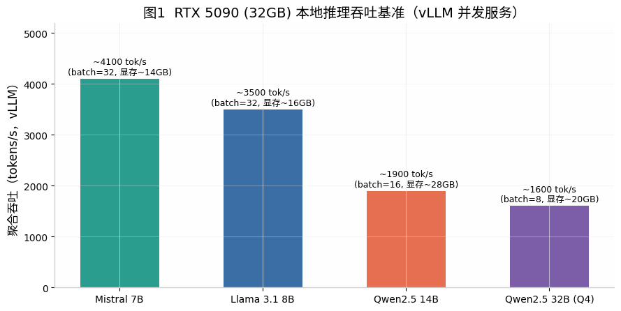
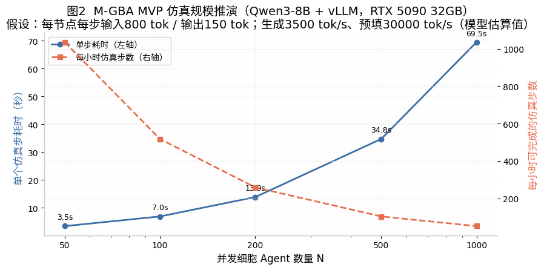
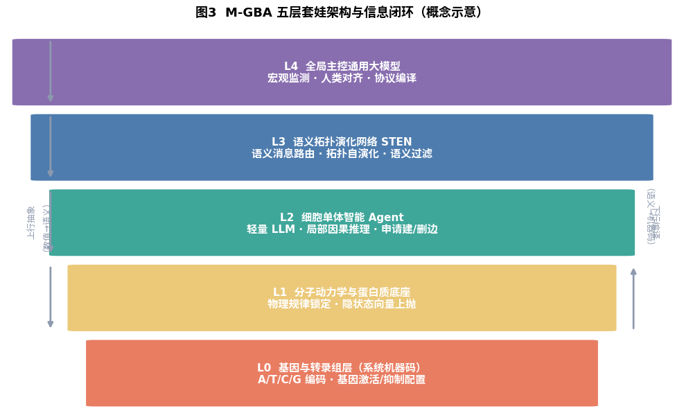
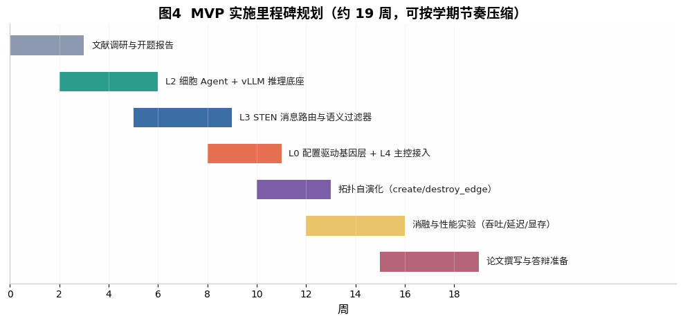

# M-GBA 涌现式数字生命仿真系统：本科毕设 MVP 落地深度调研报告

> 调研对象：《基于跨尺度图智能生物体架构（M-GBA）的涌现式数字生命仿真系统》设计文档
> 调研目标：评估该设计转化为软件工程本科毕业论文（题目暂拟《基于图神经网络与轻量级大模型的分布式多智能体协同仿真系统设计与实现》）的**新颖性、技术可行性与工程落地路径**
> 目标硬件环境：**AMD Ryzen 9 9950X + NVIDIA RTX 5090（32GB 显存）台式工作站**
> 调研完成时间：2026 年 8 月

---

## 摘要

本报告围绕 M-GBA 设计文档的毕设 MVP 转化方案，从六个维度展开系统调研：（1）LLM 多智能体仿真领域的研究版图与选题坐标；（2）STEN 引擎三大创新点（语义消息传递、Agent 驱动拓扑演化、抗过平滑）与现有文献的逐一对照；（3）9950X + RTX 5090 32GB 硬件平台上的可行性重估与规模推演；（4）编排框架、图计算库、推理引擎、节点模型的技术选型；（5）实验设计与答辩指标体系；（6）风险识别与答辩应对策略。

**核心结论**：该选题具备扎实的文献根基和清晰的技术空白区间，其"组合式创新"定位（生物隐喻分层 × 语义消息路由 × Agent 自主拓扑管理）在本科毕设尺度上新颖性充分；但需注意 2025–2026 年已出现多篇与单个创新点高度邻近的工作（尤其是 MOC 的显式消息传递机制与 GPTSwarm 谱系的拓扑优化），论文中必须主动引用并界定差异。硬件方面，RTX 5090 32GB 远超文档原先假设的"个人笔记本"，MVP 节点规模可从 50 个上修至 **100–500 个并发 Agent**，且可承载 32B 级主控模型与 8B 级细胞模型的双层模型配置，建议相应调整论文中的实验设计以充分利用算力冗余。

---

## 一、选题坐标：LLM 多智能体仿真研究版图

### 1.1 领域正处于高速扩张期

以大语言模型为核心驱动力的多智能体系统（LLM-based Multi-Agent System, LLM-MAS）在 2023–2026 年间完成了从概念验证到基础设施化的跃迁。综述性工作已经形成体系：Wang 等人发表于《Frontiers of Computer Science》的自主智能体综述引用量已超过 4800 次  [(OpenReview)](https://openreview.net/pdf?id=9axZcDTiJm) ，Guo 等人在 IJCAI 2024 发表的 LLM 多智能体综述系统梳理了该领域的进展与挑战  [(Github)](https://github.com/Najel-A/Multi-Agent-Collaboration-System/blob/main/multi_agent_systems_literature_review.md) ，Luo 等人 2025 年的综述则进一步覆盖了方法论、应用与挑战三个层面  [(TechRxiv)](https://www.techrxiv.org/doi/pdf/10.36227/techrxiv.177272839.92930143) 。这意味着毕设的"相关工作"章节有丰富的权威文献可引，同时也意味着评审导师对该领域的基本概念不会陌生——这既是利好（沟通成本低）也是约束（创新点必须经得起文献比对）。

在"智能体社会仿真"这一与本设计最接近的分支上，标杆工作脉络清晰：斯坦福的 Generative Agents（25 个智能体在沙盒小镇中展现可信的社交行为）开创了生成式智能体范式  [(OpenReview)](https://openreview.net/pdf?id=vZgdho8Vx0) ；Altera 公司的 Project Sid 将规模推至 1000+ 个 Minecraft 智能体，观察到了角色分化、民主修宪、宗教传播等"文明级"涌现现象，并提出了专业化程度与集体规则遵从度等文明度量指标  [(Github)](https://github.com/xkLi-Allen/Awesome-GNN-in-LLMs-Papers) ；清华 FIB Lab 的 AgentSociety 在 24 张 A800 GPU 上实现了 30000 个智能体的超实时社会仿真，其并行化框架论文发表于 ACL 2025 工业赛道  [(TechRxiv)](https://www.techrxiv.org/doi/pdf/10.36227/techrxiv.177127384.46731320) 。此外，复旦 SocioVerse（千万级真实用户画像锚定）、阿里 AgentScope（万级智能体基础设施）、OASIS（百万级社交媒体仿真）等工作共同构成了该领域的规模化前沿  [(Xueguang Lyu)](https://xue-guang.com/post/llm-marl/) 。

### 1.2 本设计的差异化定位

将 M-GBA 放入上述版图可以看到，现有大规模仿真工作几乎全部以"人类社会行为"为仿真对象，而 M-GBA 选择的是**生物中心法则式的跨尺度分层仿真**——从碱基编码（L0）到蛋白质物理（L1）到细胞智能体（L2）到拓扑网络（L3）到全局主控（L4）。这一"自下而上复刻生命全尺度"的叙事在已有文献中没有直接对应物：AgentSociety 仿真的是"社会"，Project Sid 仿真的是"文明"，而 M-GBA 仿真的是"有机体"。值得注意的是，Project Sid 的作者在其局限性分析中明确指出，当前智能体"缺乏生存、好奇、社群等内在驱动力"，且基于人类知识预训练的模型"无法模拟社会创新的从头涌现"  [(Github)](https://github.com/xkLi-Allen/Awesome-GNN-in-LLMs-Papers) ——M-GBA 用基因配置层（L0）约束智能体行为的设计，恰好可以被论证为对这一类批评的工程回应：内在驱动力由底层"机器码"而非提示词显式编码。

另一条相邻的脉络是"AI 虚拟细胞"：Arc Institute 的 State 模型与 2025 年首届 Virtual Cell Challenge（吸引 114 个国家超过 5000 名参与者、1200 余支队伍）致力于用基础模型预测细胞对基因扰动的响应  [(OpenReview)](https://openreview.net/pdf?id=ZVN1DCVOIg) ；Evo 2（Arc Institute 与 NVIDIA 等联合开发，7B/40B 参数、100 万碱基上下文、9.3 万亿核苷酸训练，2026 年 3 月正式发表于 Nature）已具备零样本变异效应预测与基因组规模生成能力  [(Github)](https://github.com/masamasa59/ai-agent-papers/blob/main/application-papers/multi-agent.md) 。但这些工作的目标是预测真实细胞的表达谱，是"单细胞的数字孪生"，而非"多智能体系统的组织化涌现"。M-GBA 与它们的关系是隐喻借用与潜在组件复用（详见第 4.4 节），而非竞争——这一点在论文的文献综述中应当明确写出，既能展示调研深度，也能避免"重复造轮子"的质疑。

### 1.3 选题定位小结

综合版图分析，本选题在新颖性上的安全表述是：**"首个将生物中心法则分层范式引入 LLM 多智能体仿真工程架构的概念验证系统"**。它不是拓扑优化算法的首创者（该方向已有密集文献，见第二章），也不是最大规模的智能体仿真，而是在软件工程视角下提出了一套具备自洽分层语义、可解释信息闭环（上行抽象/下行编译）的系统架构。对本科毕设而言，这个定位的新颖性绰绰有余，且工程可交付物明确。

---

## 二、STEN 引擎三大创新点的文献比对

设计文档的第二章提出了 STEN 引擎的三个核心创新。本章逐一与现有文献对照，结论是：**三个创新点各自都已有邻近工作，但三者的组合形态以及"由 Agent 语义推理结果直接驱动图结构变更"的完整闭环，在当前文献中尚无完全等价物**。

### 2.1 语义消息传递（Semantic Message Passing）

文档主张"边传递结构化语义载荷而非压缩数值向量"。文献比对发现，这正是 2025–2026 年的活跃研究方向：MOC（Multi-Order Communication, 2026）在相关工作分析中明确指出，GPTSwarm、G-Designer、MacNet 等图化多智能体框架"主要聚焦拓扑设计，在很大程度上忽视了通信管道本身——语义消息如何沿边传输与优化"，并针对性地提出了边上显式消息传递机制  [(yespress.io)](https://yespress.io/joon-park) 。这既是威胁（该创新点正被学术界同时抢占），也是机会（证明该问题被公认为空白）。

M-GBA 与 MOC 的可差异化之处在于：MOC 的消息传递仍服务于"任务求解准确率"这一外部目标，而 M-GBA 的语义边协议是**生物符号协议**（模拟细胞因子、激素信号），其语义过滤器承担的是"局部微环境因果推理的输入整形"功能，评价目标是系统级指标（吞吐、延迟、多样性保持）而非任务准确率。论文中建议设置专门一段与 MOC、AgentPrune  [(Github)](https://github.com/CodeOfMe/LLMAP/blob/main/references.md)  等工作做对照讨论，主动界定差异可显著降低答辩风险。

### 2.2 Agent 驱动的拓扑自主演化

"连接关系由细胞 Agent 的意志决定，主动调用 create_edge() / destroy_edge()"——这一设计在文献中的最近邻是智能体通信拓扑优化谱系：GPTSwarm 将智能体系统建模为可优化计算图、用 REINFORCE 训练边概率  [(Github)](https://github.com/taichengguo/LLM_MultiAgents_Survey_Papers) ；DyLAN 用重要性评分动态剪枝团队  [(arXiv.org)](https://arxiv.org/html/2412.17481v2) ；G-Designer 用图神经网络安全预测任务自适应拓扑；AgentPrune/AgentDropout/SafeSieve 做运行期边与节点剪枝  [(Github)](https://github.com/CodeOfMe/LLMAP/blob/main/references.md) ；MASS 揭示提示词与拓扑联合搜索的相互强化效应  [(Stanford HAI)](https://hai.stanford.edu/news/computational-agents-exhibit-believable-humanlike-behavior) ；TacoMAS、TopoDim、OFA-MAS、CARD 等 2026 年新工作继续推进该方向  [(arXiv.org)](https://arxiv.org/pdf/2510.17149?) 。此外，ACL 2025 的《LLM-Based Multi-Agent Systems are Scalable Graph Generative Models》直接将多智能体系统视为可扩展的图生成模型  [(latenode.com)](https://latenode.com/blog/langgraph-vs-autogen-vs-crewai) 。

**关键差异点**：上述所有工作的拓扑优化器都是**外部的、目标驱动的**（强化学习控制器、GNN 预测器、重要性评分），优化目标是下游任务效用；而 M-GBA 的拓扑变更是**内生的、意志驱动的**——边的新建与销毁是节点自身 LLM 推理的输出动作（工具调用），优化目标内生于节点的局部利益而非全局效用。这一"外生优化 vs 内生演化"的分野在 MDPI 2026 年的多智能体编排综述中被明确列为未解决的开放挑战（自组织多智能体系统）  [(latenode.com)](http://latenode.com/blog/langgraph-vs-autogen-vs-crewai-complete-ai-agent-framework-comparison-architecture-analysis-2025) 。建议论文将这一对照做成表格（见表 1），作为核心创新论证的骨架。

**表 1  M-GBA 与拓扑优化谱系代表工作的定位对比**

| 工作 | 年份/发表 | 拓扑由谁决定 | 优化目标 | 边上载荷 | 与 M-GBA 的关系 |
|---|---|---|---|---|---|
| GPTSwarm  [(Github)](https://github.com/taichengguo/LLM_MultiAgents_Survey_Papers)  | 2024 / ICML | 外部 RL 优化器 | 下游任务效用 | 文本消息 | 外生优化的代表，必引 |
| DyLAN  [(arXiv.org)](https://arxiv.org/html/2412.17481v2)  | 2024 | 重要性评分剪枝 | 任务准确率 | 文本消息 | 动态团队选择先驱 |
| AgentPrune  [(Github)](https://github.com/CodeOfMe/LLMAP/blob/main/references.md)  | 2025 / ICLR | 一次性掩码矩阵 | 通信经济性 | 文本消息 | 剪枝基线 |
| G-Designer | 2025 | GNN 拓扑预测器 | 任务准确率 | 文本消息 | 学习式拓扑设计 |
| MOC  [(yespress.io)](https://yespress.io/joon-park)  | 2026 | 预设图 + 消息优化 | 通信语义质量 | **显式语义消息** | **最近邻，必须正面对照** |
| ACL'25 图生成视角  [(latenode.com)](https://latenode.com/blog/langgraph-vs-autogen-vs-crewai)  | 2025 / ACL | 智能体交互涌现 | 图结构合理性 | 交互记录 | 理论视角相近 |
| **M-GBA（本设计）** | 毕设 MVP | **节点 Agent 自主调用接口** | **内生于节点局部推理** | **结构化生物符号协议** | 组合式创新 |

### 2.3 抗过平滑设计的文献基础

传统 GNN 的过平滑问题已有成熟的理论刻画与系统的缓解方法分类。Jin 与 Zhu 的综述提出了 ATNPA 统一框架（增强、变换、归一化、传播、聚合五步法），将缓解方法归为能量正则化、动力系统建模、传播-变换解耦三大主题，涵盖 DropEdge、GCNII、PairNorm、GRAND 等代表性方法  [(latenode.com)](https://latenode.com/blog/langgraph-vs-autogen-vs-crewai-complete-ai-agent-framework-comparison-architecture-analysis-2025) 。文档中"层数超过 3 层导致节点特征趋同"的表述与文献一致（Li et al. 2018 的经典证明被广泛引用）  [(latenode.com)](https://latenode.com/blog/langgraph-vs-autogen-vs-crewai-complete-ai-agent-framework-comparison-architecture-analysis-2025) 。

需要提醒论文写作注意一个表述风险：M-GBA 的"免疫过平滑"论证是**架构层面的定性论证**（Agent 隐状态受基因配置与 System Prompt 锚定，不存在逐层数值传播），而非经过实验验证的定量结论。答辩时若遇到图神经网络方向的评委，很可能被追问"你如何度量多样性保持"。建议提前准备一个可计算指标——例如定义节点状态的**两两语义余弦距离分布**或策略熵，在消融实验中对"纯数值聚合基线 vs STEN 语义路由"做对比曲线，把定性主张变成定量证据。GNN×LLM 融合的最新综述（文本属性图 TAG 方向，POMACS 2025）也可作为该节的理论引用  [(Getting Started with AI)](https://gettingstarted.ai/blog/best-multi-agent-ai-framework/) 。

---

## 三、硬件可行性重估：9950X + RTX 5090 平台的真实能力边界

### 3.1 从"笔记本 50 节点"到"工作站数百节点"

设计文档按"个人笔记本"假设将 PoC 规模定为 50 个节点。你的实际硬件——Ryzen 9 9950X（16 核 32 线程）+ RTX 5090（32GB GDDR7，显存带宽 1792 GB/s）——是当前消费级单机的天花板配置，能力评估需要整体重写。RTX 5090 的显存带宽较 RTX 4090 提升约 78%，32GB 显存可在 Q4 量化下容纳约 50B 参数级别的模型，32B 级模型可在原生精度或高量化下全量驻留显存  [(xcelore.com)](https://xcelore.com/langgraph-vs-crewai/) 。

第三方 vLLM 实测基准给出了可直接用于论文"实验环境"章节的数据：Llama 3.1 8B 在批量 32 并发下聚合吞吐约 **3500 tokens/s**（显存占用约 16GB），Mistral 7B 约 4100 tokens/s，Qwen2.5 14B 约 1900 tokens/s，Qwen2.5 32B（Q4）约 1600 tokens/s  [(BuildMVPFast)](https://www.buildmvpfast.com/blog/langgraph-vs-crewai-vs-autogen-vs-swarms-agent-framework-2026) （见图 1）。对于多智能体仿真这种天然高并发负载，vLLM 的连续批处理是决定性优势：独立对比测试显示，在 50 并发下 vLLM 的吞吐可达 Ollama 的 **5.9 倍**，且在 128 并发下仍保持 100% 请求成功率，而 Ollama 在 5 并发左右即开始劣化  [(lilys.ai)](https://lilys.ai/zh/notes/langgraph-swarm-20260202/best-ai-agent-frameworks-autogen-crewai-langgraph) 。

### 3.2 规模推演：节点数与仿真步频的定量关系

基于上述实测吞吐，我们建立了一个简化的规模推演模型：假设每个细胞 Agent 每个仿真步消耗约 800 tokens 输入（系统提示 + 基因配置摘要 + 邻居消息聚合）与约 150 tokens 输出（决策 + 边操作请求），生成吞吐按 8B 模型 3500 tokens/s、预填吞吐按约 30000 tokens/s（5090 上 8B 模型的保守估计）计算。结果显示：**100 节点规模下单步约 7 秒，每小时可推进约 500 个仿真步；500 节点规模下单步约 35 秒**（见图 2）。换言之，文档中"50 节点"的设定在这台机器上保守了整整一个数量级。

这一推演对论文写作有直接价值：它建议将实验设计为 **50/100/200/500 节点的四档规模梯度**，既呼应原文档的保守起点，又能用"可扩展性曲线"（吞吐随节点数的变化、延迟分解、显存水位）产出答辩所需的详实图表。9950X 的 32 线程同时保证了图路由、消息序列化、日志采集等 CPU 侧流水线不会成为瓶颈——AgentSociety 的并行化研究也证明此类系统的性能随 LLM 算力近似线性扩展  [(TechRxiv)](https://www.techrxiv.org/doi/pdf/10.36227/techrxiv.177127384.46731320) 。

### 3.3 工具链兼容性注意事项

RTX 5090 属于 Blackwell 架构（sm_120），这是论文"实验环境"章节必须写清楚的一个技术点：该卡**要求 CUDA 12.8 及以上，PyTorch 需 2.7.0 或更高版本**（PyTorch 2.7 是首个提供原生 sm_120 支持的稳定版，当前推荐 2.11.0）  [(latenode.com)](https://latenode.com/es/blog/langgraph-vs-autogen-vs-crewai-complete-ai-agent-framework-comparison-architecture-analysis-2025) 。早期（2025 年上半年）的"no kernel image"报错问题已在稳定版中解决，但仍建议：固定使用 `cu128` 标签的官方镜像或 wheel；若个别量化 KV cache 内核在 sm_120 上出现异常（社区仍有零星报告），回退到 FP16/BF16 KV cache 即可  [(Brian Jhang's Edge)](https://brianjhang.com/ai/trends/ai-agent-frameworks-battle-2025/) 。这些环境配置细节看似琐碎，却是软件工程毕设中"可复现性"评分点的直接来源，建议写成独立的部署小节并附上版本锁定文件。

### 3.4 双层模型配置的可行性

32GB 显存支持一个颇具论文卖点的配置：**主控 LLM 与细胞 LLM 共卡部署**。例如 Qwen3-32B（Q4，约 20GB）作主控 + Qwen3-4B（BF16，约 8GB）作细胞模型的组合可同时在卡，或用 vLLM 单实例服务 8B 细胞模型、主控按需加载。若嫌共存调度复杂，也可让主控模型跑在 9950X 的 CPU 上（低频调用场景下可接受），把显存完全让给高频调用的细胞模型。这种"异构双层模型"的资源调度本身就是分布式系统工程的一个合法实验变量，值得写进论文。

---

## 四、技术栈选型调研

### 4.1 编排框架：LangGraph 已成事实标准，但自研调度器亦有价值

文档建议的 LangChain 技术栈依然成立，且生态状态比文档撰写时更好：LangGraph 1.0 已于 2025 年 10 月正式发布（GA），承诺零破坏性变更，其图原语（状态、节点、边）已冻结，至 2026 年 4 月 GitHub 星数超过 12.6 万，内置持久化执行、流式输出、人在回路与记忆管理四大运行时能力  [(stackademic.com)](https://blog.stackademic.com/autogen-vs-langgraph-vs-crewai-vs-opendevin-open-source-agent-framework-battle-2025-9232864f1e10) 。微软则已将 AutoGen 与 Semantic Kernel 合并为 Microsoft Agent Framework 1.0（2026 年 4 月 GA）  [(stackademic.com)](https://blog.stackademic.com/autogen-vs-langgraph-vs-crewai-vs-opendevin-open-source-agent-framework-battle-2025-9232864f1e10) 。对毕设而言，LangGraph 是稳妥默认项；但需要注意，M-GBA 的"拓扑由 Agent 运行时自主改写"需求与 LangGraph 的"图结构在编译期确定"心智模型存在张力——LangGraph 支持动态条件路由，但 create_edge/destroy_edge 这种**图结构的运行时突变**更适合用自研的异步调度器（asyncio + 消息队列）实现，把 LangGraph 仅用于单 Agent 内部的推理流程编排。这个"框架边界分析"本身就是论文系统设计中体现工程判断力的好素材。

另一种思路是完全自研调度核心。考虑到论文题目强调"分布式多智能体协同仿真系统"，一个透明可控、逐行可解释的自研调度器（含同步/异步两种时钟模式，恰好支撑文档规划的"异步/同步模式延迟对比"实验）可能比深度依赖框架更能征服软件工程背景的评委。折中方案：L2 细胞 Agent 的推理链用 LangGraph，L3 STEN 的图演化引擎自研。

### 4.2 图计算库：PyG 选型正确，DGL 必须回避

文档选用 PyTorch Geometric 的判断得到生态验证：PyG 持续活跃维护（2026 年 7 月发布 2.8.0.post1），是新 GNN 项目的默认选择  [(satyadharjoshi.com)](https://satyadharjoshi.com/wp-content/uploads/2025/02/Review-of-autonomous-systems-and-collaborative-AI-agent-frameworks-IJSRA-2025-0439.pdf) 。形成鲜明对比的是 DGL——GitHub 最后发布停留在 2024 年 9 月的 v2.4.0，仓库自 2025 年 7 月起无提交活动，社区（如材料图深度学习库 MatGL）已公开迁移至 PyG  [(satyadharjoshi.com)](https://satyadharjoshi.com/wp-content/uploads/2025/02/Review-of-autonomous-systems-and-collaborative-AI-agent-frameworks-IJSRA-2025-0439.pdf) 。不过需要指出：STEN 引擎"语义消息 + Agent 驱动拓扑"的设计实际上**不依赖 PyG 的数值消息传递算子**，PyG 在系统中的真实角色是（a）提供图数据结构、（b）支撑作为对照基线的传统 GNN 实验（数值聚合 vs 语义路由的消融对比）。建议论文中如实写明这一角色分工——"用 PyG 实现对照组"比"用 PyG 实现主引擎"更诚实也更有说服力。纯图结构操作也可用 NetworkX（2025 年 12 月发布 3.6.1）补充拓扑分析指标（度分布、聚类系数、连通分量演化），这些是答辩图表的直接素材  [(satyadharjoshi.com)](https://satyadharjoshi.com/wp-content/uploads/2025/02/Review-of-autonomous-systems-and-collaborative-AI-agent-frameworks-IJSRA-2025-0439.pdf) 。

### 4.3 推理引擎与节点模型：vLLM + Qwen3 系列

推理引擎的结论是明确的：多智能体并发场景选 vLLM（PagedAttention + 连续批处理 + OpenAI 兼容 API），50 并发下吞吐为 Ollama 的 5.9 倍  [(lilys.ai)](https://lilys.ai/zh/notes/langgraph-swarm-20260202/best-ai-agent-frameworks-autogen-crewai-langgraph) ；llama.cpp/Ollama 仅适合开发期单点调试  [(lilys.ai)](https://lilys.ai/en/notes/ai-agent-20260130/autogen-crewai-langgraph-best-ai-framework-2025) 。节点模型的选型依据是工具调用能力——因为 create_edge()/destroy_edge() 依赖可靠的 function calling：Berkeley BFCL 榜单上，Qwen3 系列在发布时即以 70+ 分大幅领先同级模型（约为 DeepSeek-R1 的两倍），Qwen3-4B 在 4B 规模即有稳定的工具调用表现（BFCL V3 得分 61.7，高于同级所有基线），Qwen3-8B 已被社区视为通用模型中工具调用的实际标准  [(CanItRun)](https://canitrun.dev/gpus/rtx-5090/) 。备选方案包括工具调用特化微调模型 ToolACE-8B（曾在 BFCL-v1 达到 GPT-4 级别）与腾讯 Youtu-LLM 2B（2B 规模 BFCL 58.0，agentic 能力突出）  [(gigagpu.com)](https://gigagpu.com/vllm-vs-llama-cpp-gpu-servers/) 。推荐组合：**细胞模型用 Qwen3-4B（高并发吞吐优先）或 Qwen3-8B（推理质量优先），主控模型用 Qwen3-32B-Q4**，两套配置都可纳入消融实验。

### 4.4 基因层与蛋白层：配置驱动是正确裁剪，可选接真实生物模型加分

文档将 L0 简化为 config.json 的策略务实且正确。若想在答辩中增加亮点，有两条低成本的"真接生物模型"路径：（1）**Evo 2 7B**——Arc Institute 全开源的 DNA 基础模型，可对 L0 的虚拟碱基序列做困惑度/熵评分，让"虚拟基因编辑"有一个真实的序列合理性裁判，其 7B 版本提供轻量安装选项，与 5090 兼容  [(Github)](https://github.com/masamasa59/ai-agent-papers/blob/main/application-papers/multi-agent.md) ；（2）**ESM-2 650M**——蛋白质语言模型，在 A6000 上嵌入一条平均长度蛋白仅需 0.09 秒，可为 L1 层提供真实的蛋白隐状态向量（1280 维），替代随机向量  [(Github)](https://github.com/scrya-com/rotorquant/issues/10) 。两者均为可选增强项而非必需项，建议在论文中列为"系统扩展性验证"，即使只完成其一也足以支撑一章实验内容。AlphaFold 级分子动力学在毕设尺度上不可行也不必行，文档将其"锁死物理规律"的定位用 ESM 嵌入向量化表达即为合理降维。

### 4.5 技术栈决策汇总

**表 2  MVP 技术栈选型决策表**

| 系统层 | 组件 | 推荐选型 | 备选 | 选型依据 |
|---|---|---|---|---|
| L4 主控 | 模型 | Qwen3-32B (Q4) | Qwen3-14B | BFCL 工具调用 70.0 分  [(CanItRun)](https://canitrun.dev/gpus/rtx-5090/)  |
| L3 STEN | 图引擎 | 自研异步调度 + NetworkX 分析 | LangGraph 全托管 | 运行时拓扑突变需自主控制  [(stackademic.com)](https://blog.stackademic.com/autogen-vs-langgraph-vs-crewai-vs-opendevin-open-source-agent-framework-battle-2025-9232864f1e10)  |
| L3 对照组 | GNN 基线 | PyTorch Geometric 2.8 | —（勿选 DGL） | DGL 已停止维护  [(satyadharjoshi.com)](https://satyadharjoshi.com/wp-content/uploads/2025/02/Review-of-autonomous-systems-and-collaborative-AI-agent-frameworks-IJSRA-2025-0439.pdf)  |
| L2 细胞 | 模型 | Qwen3-4B / Qwen3-8B | ToolACE-8B | 4B 规模 BFCL 61.7  [(salad.com)](https://docs.salad.com/container-engine/tutorials/machine-learning/pytorch-rtx5090)  |
| L2 编排 | Agent 框架 | LangGraph 1.0 | 自研 ReAct 循环 | 1.0 GA，API 冻结  [(stackademic.com)](https://blog.stackademic.com/autogen-vs-langgraph-vs-crewai-vs-opendevin-open-source-agent-framework-battle-2025-9232864f1e10)  |
| 推理服务 | 引擎 | vLLM（CUDA 12.8） | Ollama（仅调试用） | 50 并发吞吐 5.9×  [(lilys.ai)](https://lilys.ai/zh/notes/langgraph-swarm-20260202/best-ai-agent-frameworks-autogen-crewai-langgraph)  |
| L1/L0 | 生物层 | config.json（必需）+ Evo 2 7B / ESM-2 650M（可选加分项） | 随机向量 | Evo 2 已发表于 Nature  [(Github)](https://github.com/masamasa59/ai-agent-papers/blob/main/application-papers/multi-agent.md)  |
| 环境 | 运行时 | PyTorch ≥2.7 + CUDA ≥12.8 | Docker 镜像锁定 | sm_120 硬性要求  [(latenode.com)](https://latenode.com/es/blog/langgraph-vs-autogen-vs-crewai-complete-ai-agent-framework-comparison-architecture-analysis-2025)  |

---

## 五、系统架构与实施路径

### 5.1 五层架构的 MVP 语义重述

图 3 给出五层架构的概念示意：上行方向逐层抽象（数值→语义），下行方向逐层编译（语义→机器码），构成信息闭环。对 MVP 而言，各层的落地语义为：L0 是带版本控制的配置库（每节点一份基因配置，主控可热更新，天然支撑"虚拟基因编辑"演示）；L1 是隐状态向量提供者（随机初始化或 ESM-2 嵌入）；L2 是 Qwen3 系列驱动的细胞 Agent（ReAct 循环 + 工具调用）；L3 是自研的语义路由与拓扑演化引擎（本论文的技术核心）；L4 是 32B 主控，负责宏观指标监测与对齐干预。需要强调，MVP 的"涌现"演示目标应当是**可观测、可录屏、可写进论文的具体现象**——例如：切除 50% 节点后拓扑自愈的连通性恢复曲线、主控修改某基因配置后下游行为的传播链、两类细胞种群在资源竞争下的分层结构自发形成——而不是泛泛的"智能涌现"。

### 5.2 实验设计：答辩图表从这里产出

文档规划的吞吐量、通信延迟、资源开销三项指标方向正确，建议按 2024–2025 年智能体评测领域的最新方法论扩充为五维体系——业界已形成 CLEAR 框架（成本、延迟、效率、可靠性、安全性）等多维评测共识  [(spheron.network)](https://www.spheron.network/blog/rent-nvidia-rtx-5090/) 。落到本系统，推荐实验矩阵如下：

**表 3  MVP 实验设计与指标矩阵**

| 实验 | 自变量 | 因变量（指标） | 预期产出的图表 |
|---|---|---|---|
| E1 规模可扩展性 | 节点数 50/100/200/500 | 聚合吞吐（tok/s）、单步延迟、显存/RAM 水位 | 可扩展性曲线（核心图） |
| E2 时钟模式对比 | 同步 vs 异步调度 | 消息端到端延迟分布（P50/P95/P99）、吞吐 | 延迟箱线图 |
| E3 消息机制消融 | 数值聚合（PyG 基线） vs 语义路由（STEN） | 任务完成质量、节点状态多样性（余弦距离分布/策略熵） | 消融对比柱状图 + 多样性曲线 |
| E4 拓扑机制消融 | 静态拓扑 vs Agent 自主演化 | 节点切除 50% 后的连通性恢复时间、任务恢复率 | 自愈过程时间序列 |
| E5 模型配置消融 | 4B vs 8B 细胞模型；8B vs 32B 主控 | 决策质量、单步成本、吞吐 | 性价比散点图 |

E3 和 E4 是论文的灵魂实验：它们把"语义消息传递"和"拓扑自主演化"两个创新主张转化为可证伪的对照实验。延迟指标的采集建议遵循生产级智能体评测规范——在任务级而非单次调用级记录 P50/P95/P99，并同时记录每步 token 消耗  [(LLMHardware.io)](https://llmhardware.io/guides/ollama-vs-lm-studio-vs-llamacpp-vs-vllm/) 。所有实验在 5090 上完成单轮约需数小时，预留 3–4 周实验期是安全的（见图 4 的里程碑规划）。

### 5.3 里程碑规划

图 4 给出约 19 周的实施规划：前 3 周文献与开题；第 2–6 周搭建 L2 细胞 Agent 与 vLLM 推理底座（最先验证吞吐可行性，降级风险前置）；第 5–9 周实现 STEN 消息路由与语义过滤器（技术核心，与前一阶段有重叠以压缩周期）；第 8–11 周接入 L0 配置层与 L4 主控；第 10–13 周实现拓扑自演化接口；第 12–16 周跑完整实验矩阵；最后 4 周论文撰写。关键路径是 STEN 引擎，若其延期，E3 消融实验可用简化版语义协议兜底，保证论文完整性不受影响。

---

## 六、风险识别与答辩应对

### 6.1 创新性质疑风险（中风险，必须预案）

最可能的质疑是"你的工作与 GPTSwarm/MOC 有什么区别"。应对策略已在第二章铺好：表 1 的对照表直接放进论文相关工作章节，答辩时主动讲"外生优化 vs 内生演化""任务效用目标 vs 生物隐喻架构"两条分界线。另一个潜在质疑来自 2026 年 1 月的一项研究——《Rethinking the Value of Multi-Agent Workflow》证明强单智能体基线在多数自动设计的多智能体工作流上具有竞争力  [(Github)](https://github.com/dconsorte/pytorch-tensorflow-gpu) 。对此的回应是：本系统的研究对象不是"多智能体是否比单智能体更会解题"，而是"分布式语义图系统本身的工程性质"（吞吐、延迟、自愈、多样性），评价坐标系不同，该论文反而可以作为设计消融实验（E3）中"强单体基线"的引用依据。

### 6.2 叙事尺度风险（低风险，需措辞管理）

文档第三章的"失控风险""控制权难题"等内容属于远景推演，在毕设论文中应压缩为一节"讨论与伦理考量"，并明确标注系统运行在无外部副作用的沙盒内（无真实执行器、无网络出口、基因修改仅限虚拟配置）。题目与摘要中避免"数字生命"字样（正文可保留"数字生命仿真"作为应用远景），全文基调保持"分布式复杂软件系统"。这不是掩饰，而是学术写作的边界意识：MVP 验证的是系统工程性质，生命性主张留待未来工作。

### 6.3 工程风险（低-中风险，有兜底）

Blackwell 新架构的生态边角问题（个别量化内核兼容性）可通过锁定 CUDA 12.8 + PyTorch 2.7+ 官方栈、回避实验性量化内核来规避  [(latenode.com)](https://latenode.com/es/blog/langgraph-vs-autogen-vs-crewai-complete-ai-agent-framework-comparison-architecture-analysis-2025) 。小模型工具调用的失败率（4B 模型 BFCL 约 60 分意味着四成调用可能不规范）是真实的工程挑战，应对手段包括：结构化输出约束（vLLM 支持 JSON Schema 强制解码）、调用校验与重试回路、以及在论文中把"非法拓扑操作拒绝率"作为系统健壮性指标正面报告  [(Ertas AI)](https://www.ertas.ai/compare/llama-cpp-vs-vllm) 。最后，所有实验脚本与版本锁定文件随论文提交，可复现性本身就是软件工程毕设的得分点。

---

## 七、结论与行动清单

本次调研的最终判断：**该选题在 9950X + RTX 5090 平台上不仅可行，而且具备做出超越普通毕设水准的实验深度的算力条件**。原文档的 MVP 裁剪策略（配置驱动基因层、50 节点起步、聚焦工程指标）方向全部正确，需要修正的只是规模假设与技术生态的时效性（LangGraph 已 1.0、DGL 已停更、Blackwell 需要 CUDA 12.8、小模型工具调用已可用）。

立即可执行的行动清单：（1）确定最终题目并检索本校历届选题排除撞车；（2）精读 MOC  [(yespress.io)](https://yespress.io/joon-park) 、GPTSwarm  [(Github)](https://github.com/taichengguo/LLM_MultiAgents_Survey_Papers) 、AgentSociety  [(TechRxiv)](https://www.techrxiv.org/doi/pdf/10.36227/techrxiv.177127384.46731320) 、Project Sid  [(Github)](https://github.com/xkLi-Allen/Awesome-GNN-in-LLMs-Papers)  四篇最邻近文献，完成相关工作章节初稿；（3）搭建 CUDA 12.8 + PyTorch 2.7+ + vLLM 环境，用 Qwen3-8B 跑通 32 并发吞吐冒烟测试，验证图 1 的基准在本机可复现；（4）按图 4 制定学期对齐的详细计划，将 STEN 引擎列为关键路径；（5）预先设计 E3/E4 消融实验的数据采集埋点，确保"边开发边产数据"。若执行到位，这项工作有足够素材从一篇合格毕设生长为一篇可投稿的 workshop/会议短文——拓扑内生演化与生物符号协议的组合，在 2026 年的文献版图中仍是一块清晰可见的空白。

---

 [(OpenReview)](https://openreview.net/pdf?id=9axZcDTiJm) : https://link.springer.com/article/10.1007/s11704-024-40231-1
 [(Github)](https://github.com/Najel-A/Multi-Agent-Collaboration-System/blob/main/multi_agent_systems_literature_review.md) : https://arxiv.org/abs/2402.01680
 [(TechRxiv)](https://www.techrxiv.org/doi/pdf/10.36227/techrxiv.177272839.92930143) : https://arxiv.org/abs/2503.21460
 [(OpenReview)](https://openreview.net/pdf?id=vZgdho8Vx0) : https://arxiv.org/abs/2304.03442
 [(Github)](https://github.com/xkLi-Allen/Awesome-GNN-in-LLMs-Papers) : https://arxiv.org/html/2411.00114v1
 [(TechRxiv)](https://www.techrxiv.org/doi/pdf/10.36227/techrxiv.177127384.46731320) : https://aclanthology.org/2025.acl-industry.94/
 [(TechRxiv)](https://www.techrxiv.org/users/1023031/articles/1386150/master/file/data/Agent_Network_Survey-2/Agent_Network_Survey-2.pdf?inline=true) : https://arxiv.org/abs/2502.08691
 [(Xueguang Lyu)](https://xue-guang.com/post/llm-marl/) : https://github.com/Wanying-He/awesome-llm-social-simulation
 [(OpenReview)](https://openreview.net/pdf?id=ZVN1DCVOIg) : https://arcinstitute.org/news/virtual-cell-challenge-2025-wrap-up
 [(arXiv.org)](https://arxiv.org/html/2510.21131v1) : https://digivistahub.com/virtual-cell-challenge-altos-labs-generalist-prize/
 [(Github)](https://github.com/masamasa59/ai-agent-papers/blob/main/application-papers/multi-agent.md) : https://arcinstitute.org/news/evo-2-one-year-later
 [(takara.ai)](https://tldr.takara.ai/p/2501.06322) : https://arcinstitute.org/news/evo2
 [(yespress.io)](https://yespress.io/joon-park) : https://arxiv.org/html/2606.02359v1
 [(Github)](https://github.com/CodeOfMe/LLMAP/blob/main/references.md) : https://arxiv.org/html/2508.11733v3
 [(Github)](https://github.com/taichengguo/LLM_MultiAgents_Survey_Papers) : https://arxiv.org/abs/2402.16823
 [(arXiv.org)](https://arxiv.org/html/2412.17481v2) : https://www.emergentmind.com/topics/dynamic-llm-powered-agent-network-dylan
 [(Stanford HAI)](https://hai.stanford.edu/news/computational-agents-exhibit-believable-humanlike-behavior) : https://arxiv.org/html/2604.17503v1
 [(arXiv.org)](https://arxiv.org/pdf/2510.17149?) : https://arxiv.org/abs/2605.09539
 [(latenode.com)](https://latenode.com/blog/langgraph-vs-autogen-vs-crewai) : https://github.com/tamlhp/awesome-sns
 [(latenode.com)](http://latenode.com/blog/langgraph-vs-autogen-vs-crewai-complete-ai-agent-framework-comparison-architecture-analysis-2025) : https://www.mdpi.com/1999-5903/18/6/326
 [(latenode.com)](https://latenode.com/blog/langgraph-vs-autogen-vs-crewai-complete-ai-agent-framework-comparison-architecture-analysis-2025) : https://arxiv.org/html/2405.01663v2
 [(Getting Started with AI)](https://gettingstarted.ai/blog/best-multi-agent-ai-framework/) : https://arxiv.org/html/2510.21131v1
 [(xcelore.com)](https://xcelore.com/langgraph-vs-crewai/) : https://canitrun.dev/gpus/rtx-5090/
 [(5 mini Pricing Comparison)](https://langcopilot.com/posts/2025-11-01-top-multi-agent-ai-frameworks-2024-guide) : https://everylocalai.com/hardware/rtx-5090-d
 [(BuildMVPFast)](https://www.buildmvpfast.com/blog/langgraph-vs-crewai-vs-autogen-vs-swarms-agent-framework-2026) : https://www.spheron.network/blog/rent-nvidia-rtx-5090/
 [(lilys.ai)](https://lilys.ai/zh/notes/langgraph-swarm-20260202/best-ai-agent-frameworks-autogen-crewai-langgraph) : https://pub.towardsai.net/i-tested-ollama-vs-vllm-vs-llama-cpp-the-easiest-one-collapses-at-5-concurrent-users-d4f8e0e84886
 [(lilys.ai)](https://lilys.ai/en/notes/ai-agent-20260130/autogen-crewai-langgraph-best-ai-framework-2025) : https://gigagpu.com/vllm-vs-llama-cpp-gpu-servers/
 [(latenode.com)](https://latenode.com/es/blog/langgraph-vs-autogen-vs-crewai-complete-ai-agent-framework-comparison-architecture-analysis-2025) : https://docs.salad.com/container-engine/tutorials/machine-learning/pytorch-rtx5090
 [(Brian Jhang's Edge)](https://brianjhang.com/ai/trends/ai-agent-frameworks-battle-2025/) : https://github.com/scrya-com/rotorquant/issues/10
 [(stackademic.com)](https://blog.stackademic.com/autogen-vs-langgraph-vs-crewai-vs-opendevin-open-source-agent-framework-battle-2025-9232864f1e10) : https://zylos.ai/research/2026-04-14-graph-based-agent-workflow-orchestration-production/
 [(satyadharjoshi.com)](https://satyadharjoshi.com/wp-content/uploads/2025/02/Review-of-autonomous-systems-and-collaborative-AI-agent-frameworks-IJSRA-2025-0439.pdf) : https://www.falkordb.com/blog/python-graph-libraries/
 [(ijsart.com)](https://ijsart.com/public/storage/paper/pdf_2/IJSARTV11I11104303.pdf) : https://github.com/atulcthakur/matgl_local
 [(Every Local AI)](https://everylocalai.com/hardware/rtx-5090-d) : https://llmhardware.io/guides/ollama-vs-lm-studio-vs-llamacpp-vs-vllm/
 [(CanItRun)](https://canitrun.dev/gpus/rtx-5090/) : https://aiwiki.ai/wiki/qwen_3
 [(salad.com)](https://docs.salad.com/container-engine/tutorials/machine-learning/pytorch-rtx5090) : https://arxiv.org/html/2512.24618v1
 [(gigagpu.com)](https://gigagpu.com/vllm-vs-llama-cpp-gpu-servers/) : https://logdew.com/en/posts/local-llm-tool-selection-guide/
 [(towardsai.net)](https://pub.towardsai.net/i-tested-ollama-vs-vllm-vs-llama-cpp-the-easiest-one-collapses-at-5-concurrent-users-d4f8e0e84886) : https://presenc.ai/research/open-weight-function-calling-tool-use-2026
 [(Github)](https://github.com/ggml-org/llama.cpp/discussions/15180) : https://github.com/arcinstitute/evo2
 [(Github)](https://github.com/scrya-com/rotorquant/issues/10) : https://arxiv.org/html/2603.07710v1
 [(worldline.tech)](https://blog.worldline.tech/2026/01/29/llm-inference-battle.html) : https://biolm.ai/models/esm2-8m/
 [(spheron.network)](https://www.spheron.network/blog/rent-nvidia-rtx-5090/) : https://galileo.ai/blog/benchmarks-multi-agent-ai
 [(LLMHardware.io)](https://llmhardware.io/guides/ollama-vs-lm-studio-vs-llamacpp-vs-vllm/) : https://www.algolia.com/blog/ai/ai-agent-evaluation-frameworks-metrics-testing-strategies
 [(Github)](http://github.com/captainsalih/pytorch-tensorflow-gpu) : https://github.com/FuturOneAI/ai-agent-evaluation-framework
 [(Github)](https://github.com/dconsorte/pytorch-tensorflow-gpu) : https://arxiv.org/html/2601.12307v1
 [(Ertas AI)](https://www.ertas.ai/compare/llama-cpp-vs-vllm) : https://www.ertas.ai/compare/llama-cpp-vs-vllm
