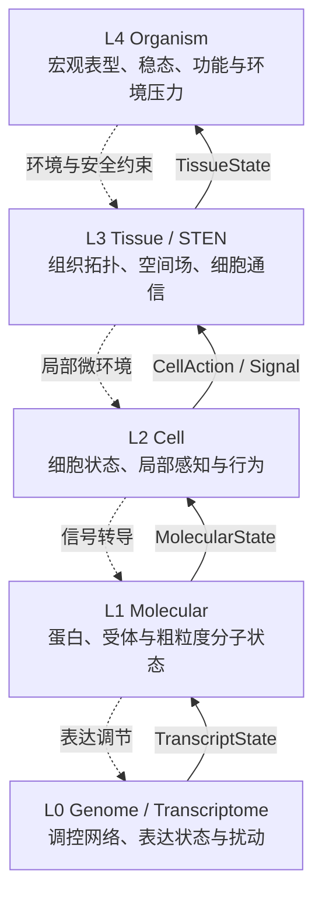

# M-GBA 跨尺度数字生命架构设计

> 版本：1.0  
> 日期：2026-08-18  
> 架构主线：L0→L1→L2→L3→L4 的自下而上生成与受约束反馈

## 1. 架构目标

M-GBA 要构建的是一个可运行、可替换、可追踪的跨尺度数字生命研究架构。系统的首要问题是：

> 微观调控变化如何经过分子、细胞和组织层逐级放大、抵消或重组，最终形成宏观表型？

因此，架构优先级依次为：

1. 五层纵向因果链完整；
2. 层间契约显式并可追踪；
3. 局部交互能够产生未被直接编码的宏观状态；
4. 各层模型可随学习与研究进展逐步替换；
5. 多智能体通信、STEN、LLM 和性能优化服务于上述目标。

## 2. 总体结构



实线是项目的主生成流，虚线是较慢的反馈与约束流。L4 不能直接指定某个细胞的动作，否则宏观行为将变成编排结果而不是自下而上生成。

## 3. 五层职责

### 3.1 L0：Genome / Transcriptome

L0 表达“潜在能力”和“当前表达”，而不是只保存 Agent 个性标签。

MVP：

- 当前使用 6 个抽象变量：损伤响应、信号、修复、代谢、死亡和负反馈表达；
- 小型有向激活/抑制调控网络；
- 同步离散泄漏更新和显式外部损伤输入；
- 输出版本化 `TranscriptState`；
- 支持可审计的持续硬钳制敲低/过表达。

后续可替换为连续 GRN、转录组数据驱动模型或真实基因基础模型。MVP 中的抽象基因不等同于真实 DNA。

### 3.2 L1：Molecular / Protein

L1 把表达状态转换为细胞可使用的分子能力，防止 L2 直接读取基因参数。

MVP：

- 六类粗粒度状态：损伤受体、有效信号、修复、代谢、死亡执行和反馈抑制能力；
- 显式的一阶翻译—降解方程；
- 由受体门控和反馈抑制形成的最小信号激活/失活机制；
- 可关闭的 `MolecularInput.local_signal` 相邻反馈入口；
- 输出 `MolecularState` 和转换依据。

后续可接 ESM 嵌入、结构先验或动力学模型，但不在运行热路径执行全原子模拟。

### 3.3 L2：Cell

L2 是细胞个体层。每个 Cell 拥有独立状态和局部感知，由 L1 能力与 L3 微环境共同决定行为。

MVP 当前采用五态确定性状态机：静息、激活、修复、应激和死亡。状态同时保存激活、活力与压力负荷；死亡是吸收态。

Cell 只消费本 Cell 的 `MolecularState`、包含压力/资源/传入信号的 `LocalEnvironment` 和自己的上一状态。输出包含分泌、资源消耗、修复努力和凋亡动作。后续可以加入学习策略、强化学习或轻量 LLM，但规则状态机是永久基线。LLM 是 Cell Policy 的一种实现，不是细胞层存在的前提。

主运行链中 L2 的细胞表达单位是 `CellAgent`（`mgba.layers.agent`）：每个细胞一个 Agent 对象，持有 `cell_id`、`Genome` 与当前 L0/L1/L2 状态，每 tick 通过既有 `CellModel` 协议执行感知-决策-行动，并校验所有输入输出的细胞身份。LLM 等策略只能作为 `CellModel` 协议的实现接入，不改变五层协议；L0/L1 仍由 Runner 作为层服务推进，L3/L4 属于组织层状态，从不存放在 Agent 上。

输出包括：移动、分泌、摄取、增殖、凋亡、状态转换以及通信/拓扑提案。

### 3.4 L3：Tissue / STEN

L3 表达细胞群体如何形成组织结构和微环境：

- 空间邻域与物理接触；
- 分泌物、资源、压力等环境场；
- 细胞之间的结构化语义消息；
- 由局部行为引起的连接形成与消失；
- 连通性、分群、边界和组织级动力学。

当前 MVP reference model 使用固定有向图，不进行 rewiring。每个节点保存局部压力、资源与传入信号；每个 tick 只消费正式 `CellState/CellAction`、初始 `LocalEnvironment` 或上一时刻 `TissueState`，更新下一时刻节点环境并聚合组织损伤、协调信号、死亡比例和修复活动。固定拓扑是 WP5 的边界，不代表项目放弃动态拓扑；后续 STEN 必须作为可替换增强与该静态基线对照。

CAR-M 场景另有可选 `SpatialCarmTissueModel`（ADR-0023），只替换 L3。它把归一化二维坐标、12×12 压力/资源/信号场和由半径邻域生成的有向边写入 `SpatialTissueState`；免疫 Cell 的确定性移动消费当前 L2 状态与上一 L3 场，场更新消费正式 `CellAction`，空间边再参与 CAR-M 局部组织更新。坐标、场、边和 source digest 全部进入 checkpoint 与哈希链，不存在前端或模型对象中的隐藏空间状态。`SpatialTissueState` 是 `TissueState` 的显式子类型，因此既有 L4 观察器可直接消费，而固定图基线的字段集、JSON 和发布身份不变。这套坐标与场是无量纲 reference state，不对应真实长度、时间或扩散系数。

ADR-0024 用 `CarmSpatialMechanisms` 将移动、场耦合和空间邻域作为 L3 内部显式开关，形成完整 2×2×2 确定性机制审计。该开关只在审计 runner 构造时注入；默认完整空间模型身份不变。全关条件验证空间 DTO 本身不会改变公共状态，仅移动条件验证坐标只有通过场或邻域才能影响表型。

STEN 是 L3 的语义通信与可塑拓扑子系统。多智能体系统问题主要在 L2/L3 交界处出现，包括并发、消息成本、拓扑稳定性和策略趋同。

### 3.5 L4：Organism / Phenotype

L4 从 L3 聚合整体状态，例如：

- 活力与死亡比例；
- 稳态偏离程度；
- 炎症、修复或肿瘤负荷；
- 组织连通性与功能完成度；
- 对扰动的恢复能力。

当前 MVP reference model 将输出分为三类：单 tick `OrganismState` 保存活力、损伤负担、炎症、稳态和恢复能力；`PhenotypeWindow` 对同一模型版本的严格递增状态序列做描述性汇总；`OrganismOutcome` 以预先冻结的阈值区分 `STABLE/RECOVERED/DETERIORATING/FAILED`。公式及阈值由 ADR-0006 和独立配置冻结，全部输入只来自正式 `TissueState`。

L4 首先是宏观观察者，其次才是低频环境调节器。中央 LLM 未来可以帮助解释轨迹、设计实验或提出干预，但不能进入每个微观时间步直接决定结果。

## 4. 层间契约

```text
L0.step(previous_transcript, RegulatoryInput, perturbations)
    -> TranscriptState + L0PerturbationEvent
L1.step(TranscriptState, previous_molecular, MolecularInput)
    -> MolecularState
L2.step(MolecularState, LocalEnvironment, previous_cell)
    -> CellState + CellAction
L3.step(CellState, CellAction, initial_environment | previous_tissue, fixed_edges)
    -> TissueState
L3.spatial_step(CellState, CellAction, initial_environment | previous_spatial_tissue)
    -> SpatialTissueState(TissueState + coordinates + field_grid)
L4.step(TissueState) -> OrganismState
L4.summarize(OrganismState trajectory) -> PhenotypeWindow + OrganismOutcome
```

每个转换事件记录：输入摘要、输出摘要、模型版本、时间尺度和转换理由。任何层不得读取非相邻下层的内部对象；实验工具可以读取全部层做观测，但不能改变运行结果。

`RegulatoryInput` 是显式标记的外部实验边界，不是 L3/L4 绕层控制 L0 的通道。当前 `damage_signal` 只直接作用于 L0 的抽象损伤响应节点；未来的系统反馈仍必须按 L4→L3→L2→L1→L0 相邻路径实现。

`MolecularInput` 是 L2→L1 的正式相邻信号入口。当前单步 Runner 将 `local_signal` 固定为 0 并在 trace 中记录；L1 不得自行读取 Cell、Tissue 或 Organism 内部状态。

`LocalEnvironment` 是 L3→L2 的正式局部边界，当前包含压力、资源和传入信号。Cell 不能读取完整 Tissue、其他 Cell 内部状态或 L4 指标。

## 5. 时间与闭环

真实生命层级具有不同时间尺度。当前 `MultirateCrossScaleRunner` 使用无量纲整数时钟：

- L1/L2/L3 每个快速 tick 更新；
- L0 从 tick 1 开始每 5 tick 更新，其余 tick 保持上一正式状态；
- L4 从 tick 1 开始每 10 tick 生成计划观测，运行终点另生成不改变历史的只读观察；
- 上一 L2 的激活经 `MolecularInput` 进入下一 L1；上一 L3 节点经 `LocalEnvironment` 进入下一 L2；
- L4→L3 的低频反馈已有可选参考实现（ADR-0012）：`FeedbackPolicy` 在每次 L4 观测后生成 `FeedbackConstraint`（资源上限 + 压力地板），从下一个 tick 起进入 `ConstraintAwareTissueModel`；它不越过 L3/L2 直接控制 Cell，约束进入 L3 source digest 哈希链留痕。无注入时行为与 0.2.0 位级一致。

Runner 为每个 tick 保存相邻转换事件，并以确定性哈希链、纯 JSON checkpoint 和实验 manifest 支持暂停恢复。同一实验连续运行或在完整 tick 边界分段恢复必须得到相同最终状态与摘要。默认频率不是生物学时间测量。

## 6. 运行时组件

| 组件 | 职责 |
|---|---|
| `ReferenceCrossScaleRunner` | 单 tick 五层契约回归基线 |
| `MultirateCrossScaleRunner` | 按冻结时钟推进五层、闭合相邻快速反馈、生成 trace/checkpoint |
| `GenomeModel` | L0 调控更新与扰动 |
| `MolecularModel` | L0→L1 表达和分子状态转换 |
| `CellModel` | L1+局部环境→L2 行为 |
| `TissueModel` | L2 行为→L3 空间、场和拓扑变化 |
| `PhenotypeModel` | L3→L4 宏观指标 |
| `FeedbackPolicy` | L4→L3 低频、受约束环境反馈；已实现为 PI+反饱和+安全屏障参考控制器 |
| `ActiveInferenceCellModel` | L2 可选推理型策略：预期自由能最小化选择相位（ADR-0013），规则状态机保留为基线 |
| `LatentCellModel` | L2 可选连续潜状态策略：冻结权重嵌入 + 泄漏 tanh 递推 + 非死亡四相读出（ADR-0019），规则状态机保留为基线 |
| `DynamicTopologyTissueModel` | L3 可选受治理动态拓扑：应激回避 T1 边交换 + 授权预算（ADR-0014），固定图保留为基线 |
| `SpatialCarmTissueModel` | CAR-M 可选因果空间 L3：checkpoint 完整的归一化坐标、三通道场与半径邻域（ADR-0023），固定图 CAR-M 保留为基线 |
| `CarmSpatialExperimentRunner` | 固定图 vs 空间场的 CAR-M 单层配对对照，另报告位移、边周转、场异质性与场梯度 |
| `CarmSpatialAblationRunner` | movement×field×topology 的 2×2×2 L3 内部确定性机制审计（ADR-0024），报告四对匹配的描述性主效应 |
| `mgba.spatial_anchors` | 生成链外的 L3 数据锚定边界（ADR-0026）：有许可/摘要的 observation bundle → 不可逆样本别名 + 预注册场/邻域统计 target；Jackson 只作 external validation |
| `SpatialAnchorEvaluator` | 正式 `SpatialTissueState` → 24 个同构 target metric → calibration/holdout/external-validation 描述性距离（ADR-0027）；只读、不调参 |
| `mgba.spatial_source_adapters` | 生成链外源格式边界（ADR-0028）：逐文件 Rights/bytes/SHA-256 核验的 Wu 10x 与 Jackson IMC CSV → 临时 observation bundle；透明基因代理与 cluster exact map 均在统计前冻结 |
| `StateConditionedInterventionRunner` | 生成链外 timing×exposure 协议（ADR-0029）：同一显式 L0 clamp 在不同 baseline state 施加，强制 onset 前逐层零差异，报告相邻层传播、timing contrast 和 raw trace |
| `mgba.lab` | 生成链外比赛数据契约（ADR-0030）：受限 request、统一 `LabRunBundle`、小型 catalog 与 SHA-256 manifest；只转换既有 raw/frozen artifact |
| `web/` | React 观察与实验工作台：按实验延迟加载 bundle、同步双轨回放、逐 Cell L0→L4 检查、证据页与分享结果；不 import 或执行核心层模型 |
| `web/app/api/experiments` | Cloudflare Worker 边界：严格枚举、确定性 run ID、服务凭证隔离、超时/限流、R2 30 天缓存和显式 fallback |
| `mgba.lab_server` | 可容器化受限执行边界：只运行已冻结 CAR-M 状态条件配对实验；核心包继续零 Web 框架依赖 |
| `NoisyDiscreteGrnModel` | L0 可选种子化转录噪声：确定性右端 + 有界乘性噪声（ADR-0015），确定性 GRN 保留为基线 |
| `NeuralGrnModel` | L0 可选冻结权重 MLP 契约演示器（ADR-0017），确定性 GRN 保留为基线 |
| `GnnTissueModel` | L3 可选冻结权重消息传递 GNN 契约演示器（ADR-0017），固定图参考模型保留为基线 |
| `NeuralComparisonRunner` | 参考 vs 神经单层替换配对对照（E2 式），构造器强制仅 L0 或仅 L3 不同 |
| `mgba.calibration` | 预注册确定性参数搜索核心（ADR-0018）：sha256 种子扫描 + 坐标细化，参考向量恒为首评点，结果只写 artifact 不改冻结配置 |
| `E3ExperimentRunner` | 多种子噪声集合 + 预注册判据分级（aggregation/group dynamics/emergence candidate） |
| `ClosedLoopExperimentRunner` | 噪声开环/噪声闭环/确定性闭环三条件 + 预注册稳定性判据分级（ADR-0016） |
| `AutolabSession` | 元层自动实验调度：预注册假设注册表 + 冻结筛选→确认策略 + fail-closed 提案门禁（ADR-0020），不进入 tick 循环 |
| `mgba.data_registry` | 入库数据集注册表加载与 SHA-256 校验（ADR-0021）：materialized/generated 实测比对、planned 免文件，只出 verdict 不进生成热路径 |
| `EventStore` | 保存层内和层间事件、快照与实验 manifest |
| `CausalExperimentRunner` | 同 seed 配对扰动/消融、逐层距离、传播 tick 和 artifact |

各层先有一个简单参考实现，再通过接口替换为 ML/GNN/LLM 模型。模型复杂度升级不能改变实验协议。

## 7. 最小纵向切片

首个场景采用“虚拟组织损伤—修复—稳态”作为契约演示：

1. L0：信号、修复、代谢相关抽象基因表达；
2. L1：转换为信号蛋白、修复蛋白和代谢能力；
3. L2：细胞进入静息、激活、修复或死亡状态；
4. L3：细胞信号与局部连接改变组织协调和资源分布；
5. L4：形成整体活力、炎症和稳态指标。

一次 L0 修复基因敲低必须在 trace 中显示 L1 修复能力下降、L2 存活/行为变化、L3 组织状态变化以及 L4 活力变化。这个演示只证明跨层契约工作，不证明生物真实性或涌现。

## 8. 多智能体与 STEN 的位置

多智能体不是架构入口。只有当 L2 已经存在多个 Cell、L3 已经需要局部通信时，才引入：

- `SemanticMessage`；
- Agent 独立邮箱和策略；
- `create_edge` / `destroy_edge`；
- 同步/异步调度；
- 结构化输出与 LLM Gateway。

STEN 实验回答的是“组织通信机制如何影响跨尺度结果”，而不是单独构成 M-GBA 的全部创新。

## 9. 可复现性与涌现判据

每次实验保存全部层级的配置、模型版本、种子、事件和快照。需要区分：

- **跨层传播**：L0 扰动能到达 L4；
- **因果贡献**：冻结/替换某层会改变结果；
- **群体动力学**：多个局部单元交互形成组织模式；
- **涌现**：宏观模式未被直接编码进单元目标，跨种子仍稳定出现。

只有最后一项满足预注册判据时，论文才使用“涌现”一词。

当前 WP8 只计算 reference 状态空间中的平均绝对距离和有向 L4 差值。三个 seed 的轨迹效应完全相同，因为模型尚无随机动力学；因此当前不报告 p 值、置信区间或跨 seed 涌现稳定性。完整 21-run raw trace 作为后续统计与图表的唯一输入。

WP9 的 reporting 是核心模型之外的只读观察层。它只读取 matrix manifest 和完整 raw run，重算逐层距离、最终 L4 差值与时间序列；`derived/summary.json` 不是输入。输出为可重建 CSV、标准库 SVG、无 JavaScript 的静态 HTML 和每个文件的 SHA-256。该层不导入 L0–L4 模型，不修改 raw trace，也不能在绘图时调参。

ADR-0030 在同一观察边界上增加比赛网站。`mgba lab-export` 是唯一预计算数据转换入口，输出 catalog、独立 bundle 和文件 manifest；浏览器只读这些导出物。在线请求也不允许用户提交路径、Cell 列表、任意配置或代码，而是由 Worker 将严格枚举的 `LabExperimentRequest` 代理给隔离 Python 服务。Python 服务只能调用已经存在的状态条件 runner 生成一对 baseline/intervention，结果回到 R2 后由分享页只读展示。UI 状态、R2 对象和网络失败均不可能写回 L0–L4；后端关闭时返回错误并由浏览器明确选择冻结回放。真实空间 Target 缺失继续作为一等状态展示，合成 fixture 不进入比赛证据。

## 10. 旧 CAR-M 项目的迁移

旧项目不是被丢弃的原型，而是 M-GBA 的中层资产：

- `cell.ts` 和 `field.ts` 提供已有 L2/L3 动力学；
- TCGA/GAT 的患者级预测只作为场景初始化代理或外部对照，不能跳过 L2/L3 直接进入 L4；
- STRING PPI 图和 GAT 架构只有在定义明确的层内目标后，才可作为 L1 或 L3 的候选替换模型；
- 宏观统计可映射为部分 L4 表型；
- 新项目需要在其下方补 L0/L1，在上方补明确的 L4 和反馈；
- 浏览器 UI 最后通过稳定 DTO 接入，不参与层级因果计算。

迁移顺序应是“先建立层间契约，再把旧 L2/L3 包装为插件”，而不是重写所有旧代码。

v0.2 已按此顺序增加 `mgba.scenarios.carm`：L0/L1/L4 保留参考模型，CAR-M 只实现 L2/L3 协议。工程化巨噬细胞与野生型巨噬细胞共享基础 Genome 和 Cell 规则，CAR 差异必须由 L0 群体钳制逐层传播。ADR-0023 又增加了一个只替换 L3 的可选因果空间 reference model；它借鉴旧 ABM 的“移动—场—局部邻域”问题分解，但没有迁移旧 10 通道场、随机复制/吞噬、GAT 热路径或 React 运行状态。旧固定图 CAR-M 和前端观察投影均保持独立。

## 11. 当前初始化的含义

当前 `sten.py`、规则 Agent 和消息测试只是独立的 L3 技术试验。五层 reference model 已由多速率 Runner 组成连续轨迹，`PhenotypeWindow`、逐 tick trace、检查点与恢复均已接入；旧单 tick Runner 继续作为契约基线。WP8 已完成 7 条件 × 3 seed 的模型内反事实矩阵，WP9 已从该矩阵 raw trace 重建可校验的表格和图表。默认与三档 repair 钳制均为 `FAILED`，L2 静态替换产生最大差异并转为 `RECOVERED`。这定位了当前 L2 累积规则是优先诊断对象，不构成真实生物因果或模型优越性结论。
